### Задача 1. Навигация по основным разделам

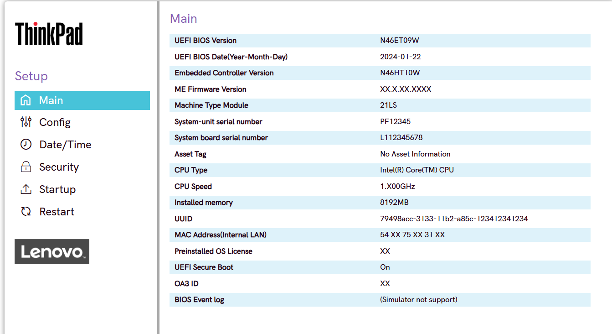

* Версия UEFI BIOS: `N46ET09W` (дата: `2024-01-22`)
* Серийный номер (System-unit serial number): `PF12345`
* Тип CPU: `Intel(R) Core(TM) CPU` (`1.X00GHz`)
* Установленная память: `8192MB`
* Статус UEFI Secure Boot: `On`

> точный путь: `Main`

### Задача 2. Смена порядка загрузки

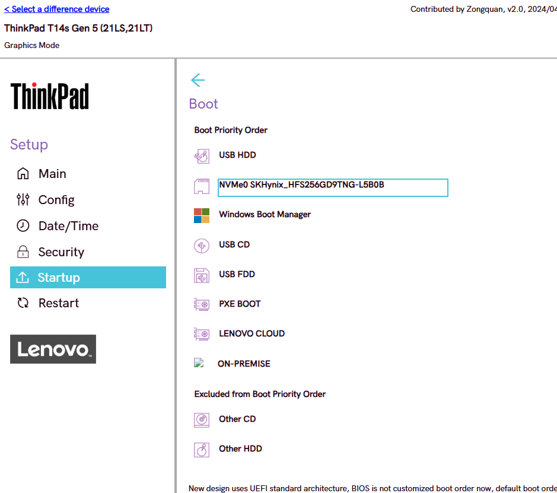

USB HDD перенесен на первое место, NVMe0 на второе

> точный путь: `Startup -> Boot -> Boot Priority Order`

### Задача 3. Включение/выключение Secure Boot

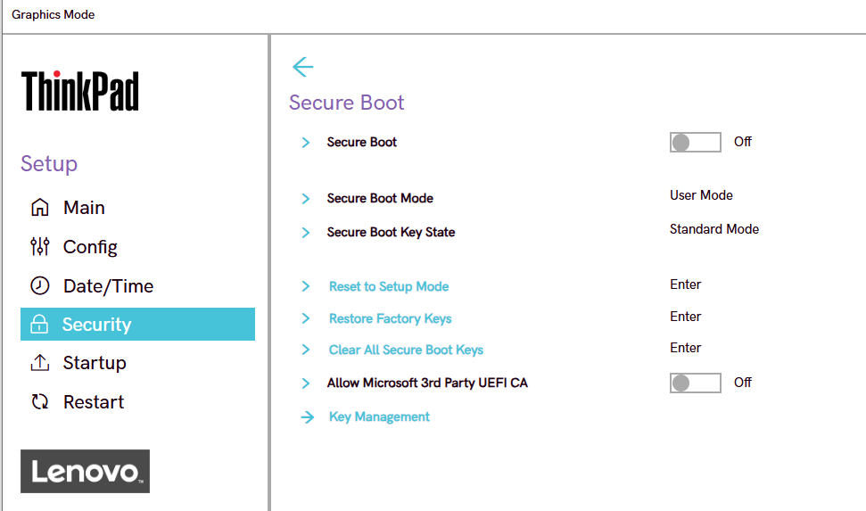

Требуется перезагрузка

> точный путь: `Security -> Secure Boot -> Secure Boot`

### Задача 4. Установка пароля супервизора

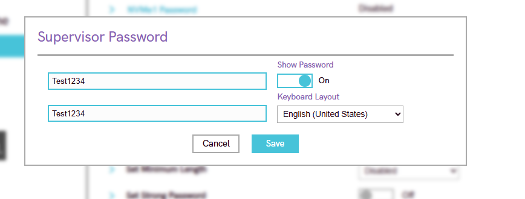

> точный путь: `Security -> Password -> Supervisor Password`

### Задача 5. Сброс на заводские настройки

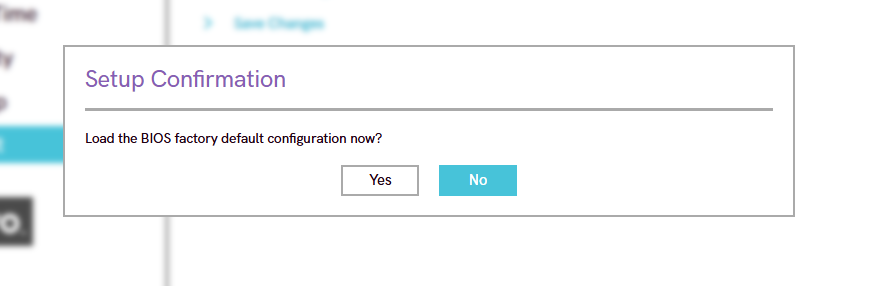

> точный путь: `Restart -> Load Factory Defaults`

сбросился порядок загрузки к исходному

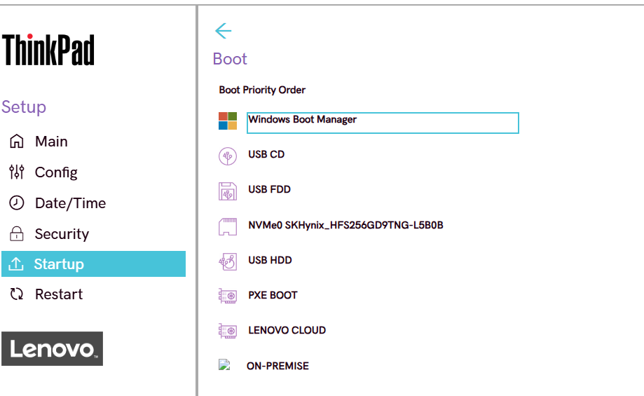

### Задача 6. Управление встроенными устройствами

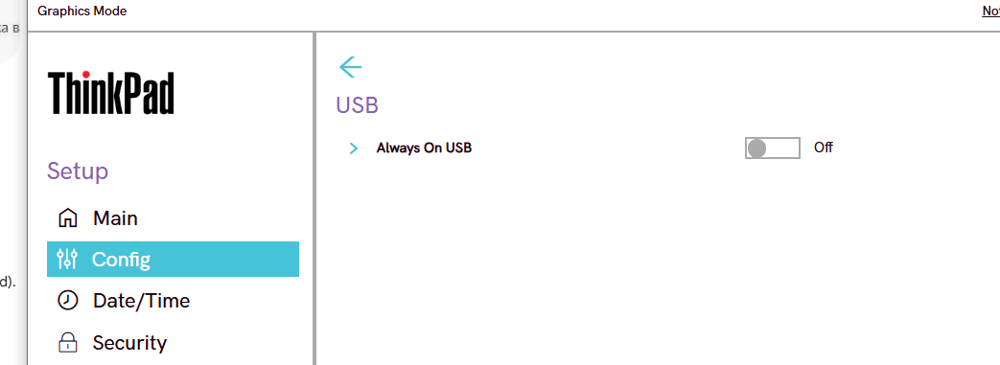

> точный путь: `Config -> USB -> Always On USB`

### Задача 7. Режим работы SATA/NVMe

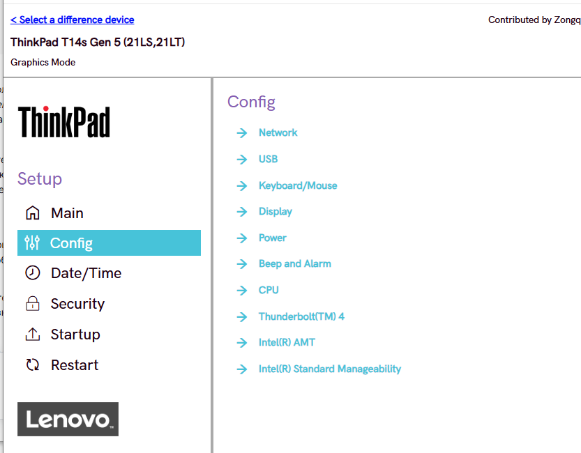

В эмуляторе ThinkPad T14s Gen 5 нет настройки режима работы накопителей

### Задача 8. Временное меню загрузки (эмуляция F12)

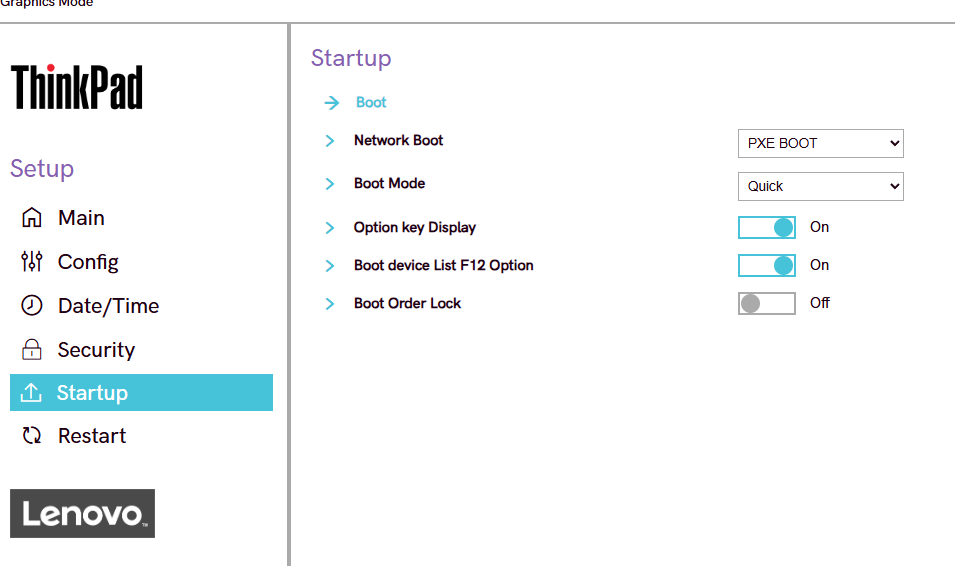

> точный путь: `Startup -> Boot Device List F12 Option`

### Задача 9. Просмотр системных логов

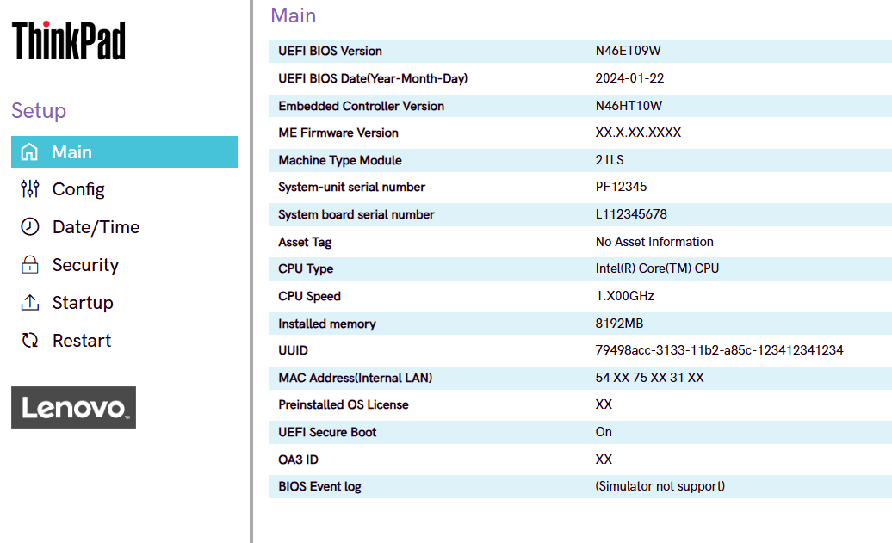

(Simulator not support)

> точный путь: `Main -> BIOS Event log`

### Задача 10. Полный сценарий: подготовка к переустановке ОС

1. Сбросить настройки на Factory Defaults

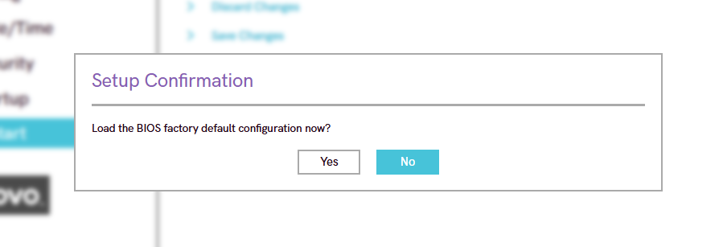

2. Включить Secure Boot

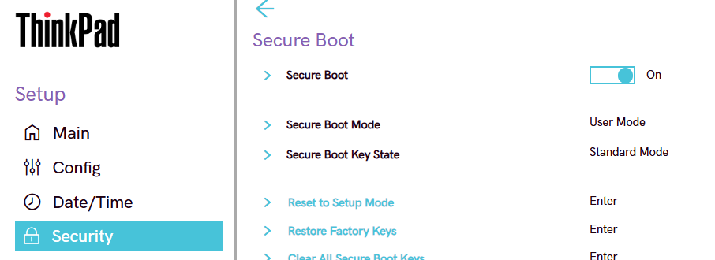

3. Установить Supervisor Password 

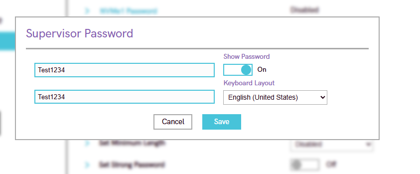
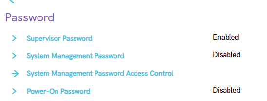

4. Поставить USB первым в порядке загрузки

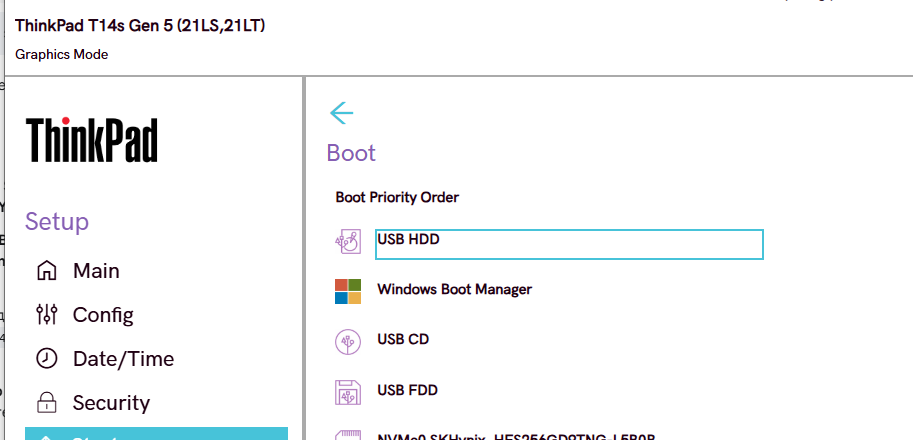

5. Сохранить и выйти

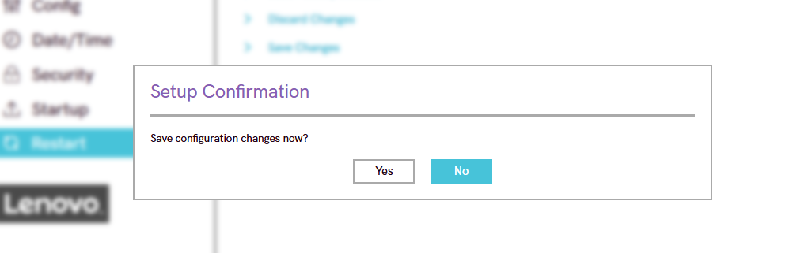

6. Снова войти, проверить настройки, сбросить пароль и вернуть порядок загрузки

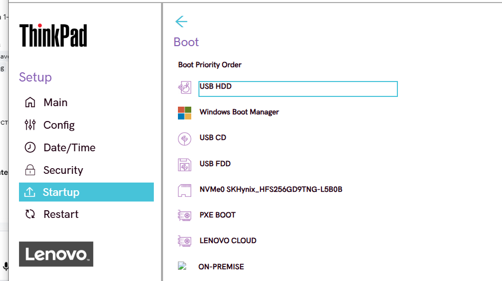

>изменения сохранились

возврат настроек:

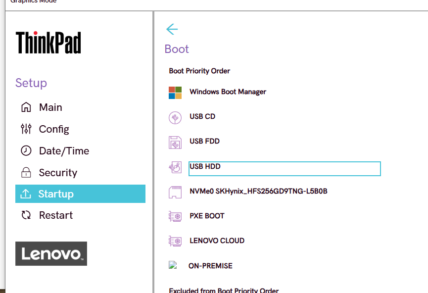
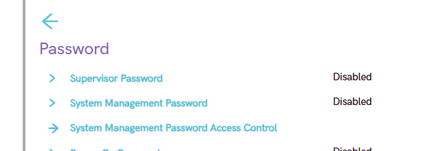
