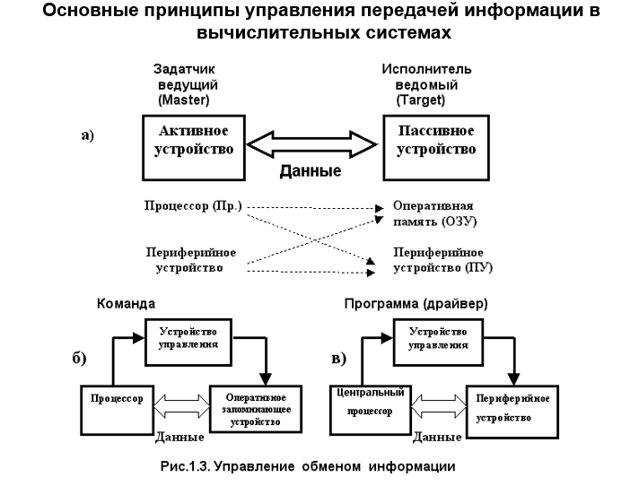
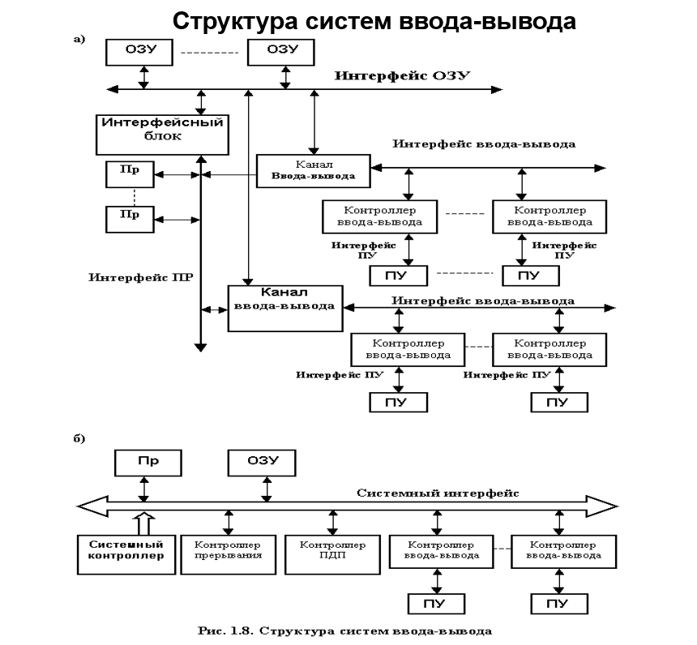

# Практические задания по теме «Системы ввода-вывода и интерфейсы»

## Задача 1. Терминология и определения (5 мин)

**Задание:** Установите соответствие между понятием и его определением. Запишите ответ в формате: 1–А, 2–Б и т.д.

| Понятие | Определение |
|---|---|
| 1. Система ввода-вывода (СВВ) | А. Группа линий интерфейса, соответствующая определённому функциональному назначению (данные, адрес и т.п.) |
| 2. Интерфейс | Б. Совокупность всех линий интерфейса |
| 3. Магистраль | В. Средства и правила, обеспечивающие взаимосвязь устройств между собой |
| 4. Шина | Г. Средства взаимосвязи и передачи информации, объединяющие ЦПр, ОЗУ и ПУ |
| 5. Канал | Д. Электрический проводник, по которому распространяется сигнал |
| 6. Линия интерфейса | Е. Среда передачи информации в виде определённых сигналов |

**Ответ:** 
| | |
|---|---|
| 1 | Г |
| 2 | В |
| 3 | Б |
| 4 | А |
| 5 | Е |
| 6 | Д |

---

## Задача 2. Классификация интерфейсов (7 мин)

**Задание:** Заполните таблицу, распределив перечисленные характеристики по видам интерфейсов. Для каждого пункта укажите, к какому признаку классификации он относится.

**Данные для распределения:**
1. Параллельный
2. Симплексный
3. Синхронный
4. Последовательный
5. Полудуплексный
6. Асинхронный
7. Дуплексный
8. Трёхшинный
9. Двухшинный

| Признак классификации | Варианты |
|---|---|
| По способу передачи данных | 1. Параллельный 4. Последовательный |
| По организации обмена |  2. Симплексный 5. Полудуплексный 7. Дуплексный |
| По способу синхронизации | 3. Синхронный 6. Асинхронный |
| По архитектуре (параллельный интерфейс) | 8. Трёхшинный 9. Двухшинный |

---

## Задача 3. Расчёт скорости передачи (8 мин)

**Задание:** Решите две задачи.

**а)** Параллельный интерфейс работает на частоте синхроимпульсов f = 100 МГц. Разрядность данных N = 16 бит. Определите скорость передачи в бит/с и байт/с.

- **Дано:** fпар = 100 МГц; N = 16 бит

- **Решение:** 
- n = 16/8 = 2 байта
- Vпар = 100 * 10^6 * 16 = 1 600 000 000 бит/c
- Vпар = 100 * 10^6 * 2 = 200 000 000 байт/c

- **Ответ:** 1 600 000 000 бит/c; 200 000 000 байт/c

**б)** Последовательный интерфейс работает на частоте f = 2,5 ГГц. Определите скорость передачи в бит/с и байт/с.

- **Дано:** fпос = 2,5 ГГц; 

- **Решение:** 
- fпос = 2,5 ГГц = 2,5 * 10^9 Гц
- Vпос = f = 2 500 000 000 бит/c
- Vпос = f / 8 = 312 500 000 байт/c

- **Ответ:** 2 500 000 000 бит/c; 312 500 000 байт/c

**в)** Сравните результаты и объясните, почему в современной технике всё шире используются последовательные интерфейсы, несмотря на то что за один такт они передают меньше данных.

| Параллельный | Последовательный |
|---|---|
| 1 600 000 000 бит/c | 2 500 000 000 бит/c |

- У последовательного скорость передачи больше.
- В современной технике все шире используются последовательные интерфейсы, из-за их дешевезны, простоты и более высогого fпос.

---

## Задача 4. Задатчик и исполнитель (10 мин)

**Задание:** Проанализируйте схему управления обменом информацией (рис. 1.3) и ответьте на вопросы.

1. Кто всегда является задатчиком (Master), а кто — исполнителем (Target) в системе «процессор – ОЗУ»?
* Задачник - процессор; Исполнитель - ОЗУ

2. Может ли периферийное устройство быть и задатчиком, и исполнителем? Приведите пример.

* Да, может... это видно на картинке ( пункт a) ).
* Пример: контроллер жесткого диска, он и читает по команде процессора, и сам пересылает данные в ОЗУ.

3. Чем отличается операция записи от операции чтения с точки зрения направления передачи данных?

* Операция записи - от задачника к исполнителю
* Операция чтения - от исполнителя к задачнику

4. Зачем функции управления вводом-выводом распределяются между несколькими устройствами (процессор, главный контроллер/канал, контроллер ПУ, блок управления ПУ)?

*  Функции управления вводом-выводом распределяются между несколькими устройствами чтобы меньше нагружать процессор при выполнении операций ввода-вывода.

---

## Задача 5. Анализ структуры системы ввода-вывода (10 мин)

**Задание:** Рассмотрите две структуры систем ввода-вывода (рис. 1.8, а и б) и выполните задания.

1. Назовите основные компоненты каждой структуры.

* **а:** процессоры, интерфейс ПР, интерфейсный блок, ОЗУ, интерфейс ОЗУ, каналы ввода-вывода, интерфейсы ввода-вывода, контроллеры ввода-вывода, ПУ, интерфейсы ПУ.
* **б:** процессор, ОЗУ, системный интерфейс, системный контроллер, контроллер прерывания, контроллер ПДП, контроллеры ввода-вывода, ПУ.

2. В чём принципиальное отличие структуры «а» от структуры «б»?

* В **структуре «а»** обмен идёт через отдельные каналы ввода-вывода и свои интерфейсы для памяти, процессоров и устройств. Каналы берут управление на себя и разгружают процессор, позволяя передавать данные параллельно.
* В **структуре «б»** процессор, память и контроллеры подключены к одной общей системной шине и работают с ней по очереди под управлением системного контроллера.

3. Какая структура, по вашему мнению, характерна для современных персональных компьютеров? Обоснуйте ответ.

* **Структура «б»** более характерна для современных ПК. Она проще и дешевле в производстве, а скоростей современных шин и ПДП вполне хватает для работы ПК.

4. Какую роль в структуре «б» играет системный контроллер и контроллер прерывания?

* **Системный контроллер** управляет работой всего системного интерфейса.
* **Контроллер прерывания** принимает сигналы от ПУ, определяет их приоритет и сообщает процессору, что нужно отвлечься и обслужить устройство. Это избавляет процессор от необходимости постоянно проверять каждое устройство самому.